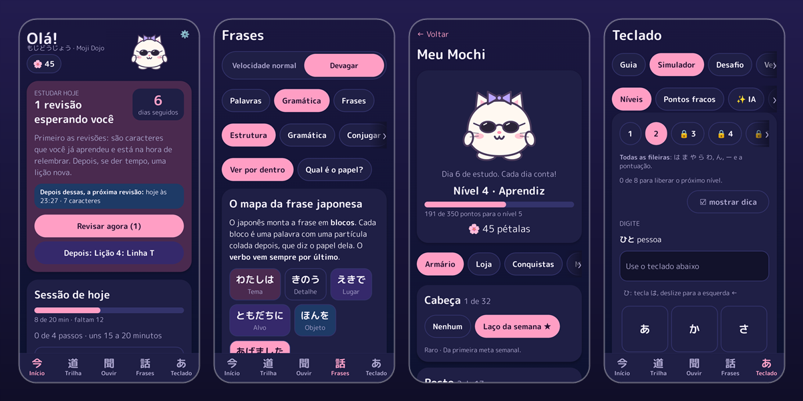
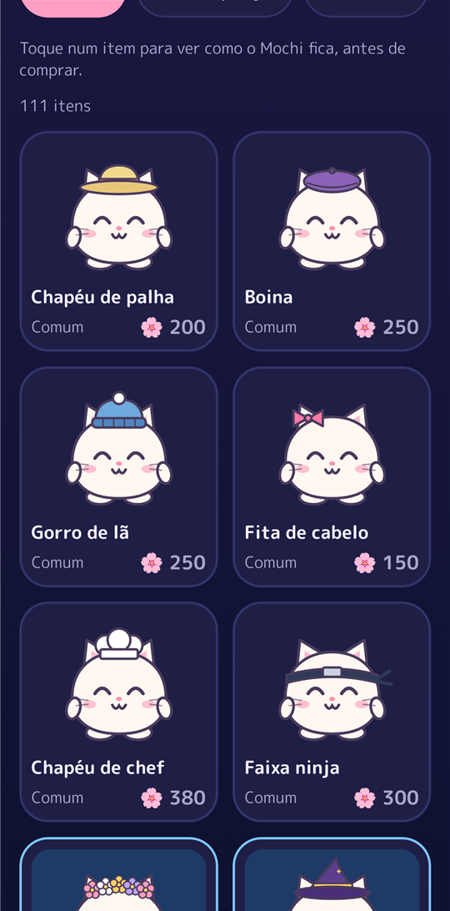
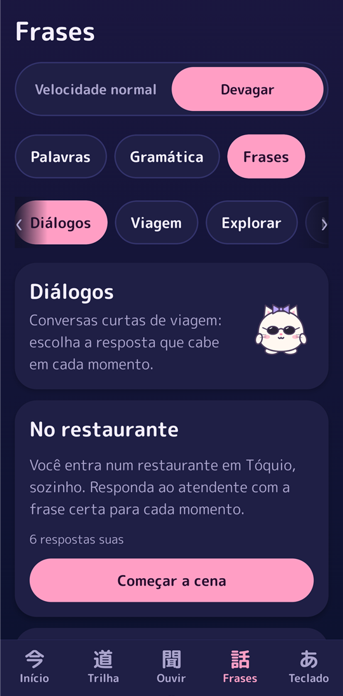
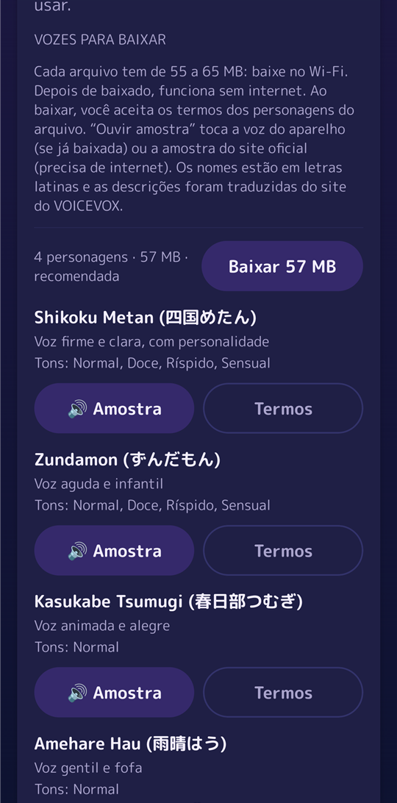
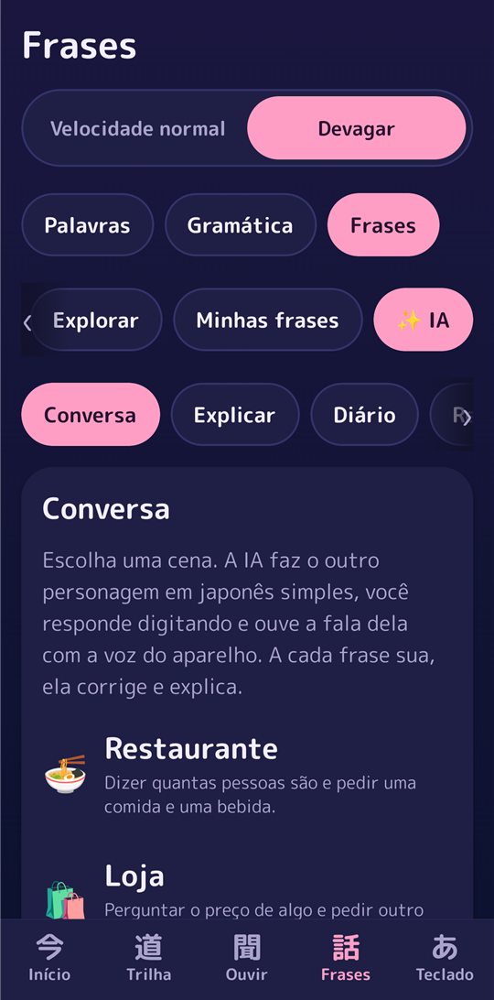

<h1 align="center">Moji Dojo 🌸</h1>

<p align="center">
  <b>App de estudo de japonês para Android</b>, com revisão espaçada, escrita com o dedo, gramática, frases, escuta e um mascote que reage aos seus acertos.<br>
  Feito com React Native e Expo. Quase tudo funciona <b>sem internet e sem conta</b>.
</p>

<p align="center">
  <a href="https://github.com/EdineiMZ/Moji-Dojo/releases/latest"></a>
  
  
  
  
  
</p>

<p align="center">
  
</p>

<p align="center">
  <a href="#baixar-e-testar-o-app">Baixar o APK</a> ·
  <a href="#funcionalidades">Funcionalidades</a> ·
  <a href="#galeria">Galeria</a> ·
  <a href="#tecnologias">Tecnologias</a> ·
  <a href="#destaques-de-engenharia">Engenharia</a> ·
  <a href="#desenvolvimento">Desenvolvimento</a> ·
  <a href="#conteúdo-licenças-e-créditos">Licenças</a> ·
  <a href="ROADMAP.md">Roadmap</a>
</p>

---

## Baixar e testar o app

[](https://github.com/EdineiMZ/Moji-Dojo/releases/latest)

A versão mais recente fica na aba **[Releases](https://github.com/EdineiMZ/Moji-Dojo/releases/latest)**, como o arquivo `MojiDojo-<versão>.apk`, com o **SHA-256** nas notas da versão.

| | |
| --- | --- |
| **Sistema** | Android 8.0 (API 26) ou mais |
| **Processador** | 64 bits (`arm64-v8a`), o que cobre praticamente todo celular de 2017 em diante |
| **Espaço** | Cerca de 115 MB para instalar. Cada voz de anime baixada (opcional) ocupa de 55 a 65 MB |

**Instalando**

1. No celular, abra a página de Releases e baixe o `.apk` da última versão.
2. Abra o arquivo. O Android pede para permitir a instalação de apps desconhecidos para o navegador ou o gerenciador de arquivos: permita só para essa instalação.
3. Abra o **Moji Dojo**. A introdução pede um nome, a meta de minutos por dia, o dia de folga e os lembretes (dá para pular).
4. Para conferir o arquivo, compare o SHA-256: `sha256sum MojiDojo-<versão>.apk` (Linux e macOS) ou `Get-FileHash MojiDojo-<versão>.apk` (Windows, PowerShell).

> **Importante, leia antes de instalar.** Este é um **APK de demonstração**, assinado com a chave de depuração padrão do Android, e não com uma chave privada do projeto. Instale **somente** a partir da página de Releases deste repositório e confira o SHA-256. Quando o projeto passar a usar uma chave própria, será preciso desinstalar antes de atualizar: use **Ajustes → Seus dados → Exportar backup** para não perder o progresso.

**Permissões e privacidade**

- Os dados de estudo ficam **só no aparelho**. Não há conta nem anúncio, e o app não tem análise de uso própria.
- **Uma exceção, do Google ML Kit** (a câmera que lê texto): segundo o Google, o ML Kit envia a ele dados técnicos (modelo do aparelho, versão do Android, nome e versão do app, um identificador por instalação e métricas de desempenho). O conteúdo das imagens não está na lista do Google. O detalhe está em **Ajustes → Créditos e licenças**.
- **Câmera:** só para ler um texto em japonês fotografado; o reconhecimento roda no aparelho.
- **Microfone:** só para gravar a sua voz (Ouvir → Repetir) e para o reconhecimento de fala, que usa o serviço de fala do Android.
- **Notificações:** só para os lembretes de estudo, que você controla.
- **Internet:** só para o que você pedir: baixar vozes de anime, ouvir a amostra de um personagem e, se você cadastrar uma chave (ou o endereço https de um servidor seu, compatível com a OpenAI), usar a IA. A chave fica no armazenamento seguro do aparelho e não entra no backup.

## Funcionalidades

**Escrever e memorizar**
- **Hiragana, katakana e 477 kanji (N5, N4 e parte do N3)**, com a ordem dos traços animada, som, exemplo e dica de memória.
- **Lição em três passos:** conhecer, escrever com o dedo e testar. A escrita é conferida **por geometria, traço a traço**, e a nota é só um guia.
- **Revisão espaçada** em que o intervalo encolhe nos itens esquecidos, com "itens teimosos", revisão mista e o modo "write" (desenhar o símbolo a partir do significado e do som).

**Vocabulário e gramática**
- Cerca de **3.500 palavras** (N5, N4 e N3) por assunto, situação de viagem e frequência, com leitura, **tom** (pitch accent), classe e frases reais; cartões em várias direções e **exportação para o Anki**.
- **113 tópicos de gramática** (51 do N5, 31 do N4 e 31 do N3) com frases do Tatoeba, mini-teste por tópico, lacunas, conjugação com revisão espaçada, contadores, números, horas e datas.

**Frases, escuta, fala e leitura**
- **Montar, Traduzir, Frases-modelo, 13 diálogos e 188 frases de viagem**, além de **30 mil frases** para explorar e buscar, tudo dentro do aparelho.
- **Ditado, compreensão, tom, shadowing com gravação da própria voz e reconhecimento de fala** em japonês.
- **Tabela de kana com treino livre e pares parecidos**, **widget da revisão do dia** e **temas de cor** (Sakura, Matcha, Oceano e Lavanda)
- **Simulado offline por nível (N5 e N4)**, com nota por seção, e **textos graduados (N5 e N4) e leitura de placas e cardápios**, com toque na palavra, furigana opcional e uma **câmera que lê texto** (OCR japonês no aparelho).

**Teclado**
- Simulador do teclado de 12 teclas com deslize (flick): níveis, conversão para kanji, mapa de calor das teclas que mais erra e frases sob medida.

**Motivação, sem pressão**
- Meta diária de minutos, lembretes locais, sessão diária guiada, missões, 42 conquistas, baús do dia e da semana e o **Mochi**: nível, humores e **178 itens** na loja (cabeça, rosto, pescoço, fundos, cores e peles, em quatro raridades), 72 deles de 12 datas comemorativas que só se compram na época (Natal, Ano-Novo, Setsubun, Namorados, Hinamatsuri, Hanami, Koinobori, Festa Junina, Tanabata, Natsu-matsuri, Tsukimi e Halloween), e a **Casa do Mochi**: sete cômodos (Quarto, Jardim, Escritório, Varanda, Sala, Cozinha e Ofurô) e 35 móveis comprados com pétalas (os cômodos pedem também metas de estudo), cada peça com uma palavra de japonês skins de cores para 19 móveis, 12 decorações de datas comemorativas (que só se compram na época) e clima (a luz segue a hora do dia, mais chuva, neve, pétalas e vaga-lumes).

**Opcionais**
- **IA com a sua própria chave** (Gemini, Claude ou GPT): corrige frases, explica erros, conversa em cenas, faz diário, simulados e textos sob medida. Sem chave, o app funciona igual.
- **Voz de anime (VOICEVOX):** vozes de 43 personagens geradas **dentro do aparelho**, com download que continua de onde parou e confere o SHA-256 oficial. O APK leva só o motor; cada pessoa baixa as vozes que quiser, depois de ver e aceitar os termos de cada personagem, e pode ouvir uma amostra antes.
- **Backup** em código de texto (`MDJ1:`) para trocar de celular.

O estado de cada item e o que vem a seguir estão no [`ROADMAP.md`](ROADMAP.md); o histórico de versões, no [`CHANGELOG.md`](CHANGELOG.md).

## Galeria

<table>
  <tr>
    <td align="center" width="25%"><br><sub><b>Loja do Mochi</b><br>178 itens em quatro raridades</sub></td>
    <td align="center" width="25%"><br><sub><b>Diálogos</b><br>13 cenas de viagem</sub></td>
    <td align="center" width="25%"><br><sub><b>Voz de anime</b><br>nomes e descrições em português</sub></td>
    <td align="center" width="25%"><br><sub><b>IA opcional</b><br>conversa por cenas</sub></td>
  </tr>
</table>

## Tecnologias

| Camada | Tecnologia |
| --- | --- |
| **Framework** | Expo SDK 57, React Native 0.86, React 19, Expo Router (rotas por arquivos) |
| **Linguagem** | TypeScript em modo `strict` |
| **Estado e dados locais** | Zustand, `expo-sqlite/kv-store` (leitura síncrona), `expo-secure-store` (chaves da IA), banco SQLite empacotado com 30 mil frases |
| **Interface e animação** | Reanimated 4, Gesture Handler, `react-native-svg` (arte do Mochi, traços e desenho), fonte M PLUS Rounded 1c |
| **Áudio e voz** | `expo-audio`, `expo-speech`, `expo-speech-recognition`, gravações de falantes nativos (Lingua Libre), VOICEVOX |
| **Módulos nativos (Kotlin)** | `voicevox`: VOICEVOX CORE com ONNX Runtime e Open JTalk, com carga e descarga de vozes. `textscan`: reconhecimento de texto japonês com Google ML Kit |
| **IA opcional** | Chamadas diretas (`fetch`) a Gemini, Claude e OpenAI, com cache, limite diário, tradução de erros e fila para pedidos sem internet |
| **Dados e conteúdo** | Pipelines em Node (`scripts/`) que geram vocabulário, frases, tom, kanji e áudio a partir de fontes abertas, com verificação contra a fonte |
| **Qualidade** | Jest com `jest-expo` (mais de 1.200 testes), ESLint, `tsc`, `expo-doctor` e um teste que trava a coerência de versão, `versionCode` e changelog |
| **Build** | `expo prebuild` + Gradle local (`gerar-apk.bat`), sem a pasta `android/` versionada |

Cerca de **40 mil linhas de TypeScript** em mais de 450 arquivos, com 126 arquivos de teste, e dois módulos nativos próprios em Kotlin.

## Destaques de engenharia

- **Escrita conferida por geometria, não por imagem.** Comparar bitmaps não separa caracteres parecidos (um 水 perfeito contra o modelo de 日 dava 81%). O app alinha o desenho ao modelo, reamostra cada traço em 24 pontos, casa os traços com o algoritmo húngaro e pontua a forma, devolvendo a ordem e a direção como feedback. [Como funciona](docs/ARQUITETURA.md#como-a-escrita-é-conferida)
- **Regras como funções puras.** Revisão espaçada, trilha, quiz, montagem de frases, teclado e backup não usam React; relógio e sorteio entram como parâmetros. Por isso os testes usam datas fixas e resultados determinísticos.
- **Síntese de voz dentro do aparelho, com download sob demanda.** O módulo Kotlin carrega e descarrega vozes `.vvm` no motor sem recriá-lo; o app baixa o arquivo para uma pasta que sobrevive às atualizações, confere o tamanho antes de aceitar e descarta uma voz que não abre. Os termos de cada personagem são mostrados e aceitos a cada download, e o bloqueio também está no código, com teste.
- **Conteúdo com origem e licença rastreáveis.** Cada fonte aberta (Tatoeba, JMdict, KANJIDIC2, KanjiVG, Kanjium, Lingua Libre, listas JLPT) está documentada com licença, alterações e pendências; scripts conferem na internet que as frases do app são as originais, e testes travam que todo personagem de voz tenha descrição e todo tom tenha tradução.
- **IA opcional e segura por desenho.** A chave fica no armazenamento seguro e fora do backup (um teste garante); só contagens e porcentagens vão para o resumo semanal; respostas que contradizem o gabarito são descartadas; sem internet, os pedidos de criação entram numa fila.
- **Offline primeiro.** Banco de 30 mil frases, OCR, reconhecimento de leitura e síntese de voz rodam no aparelho; a internet é sempre uma escolha.
- **Versionamento verificado por teste.** `app.json`, `package.json`, `package-lock.json`, o `versionCode` e o `CHANGELOG.md` precisam concordar, ou o Jest falha.

Mais sobre estrutura de pastas, dados, formato de backup e decisões técnicas: [`docs/ARQUITETURA.md`](docs/ARQUITETURA.md).

## Desenvolvimento

### Como rodar

#### Requisitos

- **Node.js LTS** (testado com a versão 22) e **Git**. No Windows: `node --version` e `git --version` devem responder.
- O app **Expo Go** instalado no Android.
- O celular e o PC na **mesma rede Wi-Fi**.

#### Passo a passo

```bash
npm install          # baixa as dependências (usa o package-lock.json)
npx expo start       # inicia o servidor de desenvolvimento
```

No Expo Go, escaneie o QR code mostrado no terminal. Se o QR não funcionar, use **Enter URL manually** e digite o endereço `exp://<IP-do-PC>:8081` (o IP aparece no terminal, algo como `192.168.0.10`).

- Se algo ficar estranho depois de mudar de versão ou de arquivo de configuração: `npx expo start -c` (limpa o cache).
- Se o celular não conectar, o Firewall do Windows costuma estar bloqueando a porta 8081 para a rede privada.
- **O Expo Go precisa suportar o SDK do projeto.** Este projeto usa o **Expo SDK 57**, que é o que o Expo Go suporta. Ao atualizar o SDK, confirme antes que o Expo Go público já o suporta.

#### Scripts

| Comando | O que faz |
|---|---|
| `npm start` | Inicia o servidor do Expo |
| `npm run typecheck` | Checa os tipos (TypeScript em modo `strict`) |
| `npm test` | Roda os testes (Jest com `jest-expo`) |
| `npm run lint` | Confere o estilo e erros comuns (ESLint) |
| `npm run generate-sounds` | Regera os efeitos sonoros em `assets/sfx/` (sintetizados por código) |
| `npx expo-doctor` | Confere se as dependências são compatíveis com o SDK |

Antes de commitar, vale rodar `npm run typecheck`, `npm run lint`, `npm test` e `npx expo-doctor`.

> **Sobre o `.npmrc`:** ele define `legacy-peer-deps=true`. O Expo fixa o React em 19.2.x, mas o npm tenta puxar um `react-dom` 19.3 como peer dependency. O app é só Android e não usa `react-dom`, então o conflito é ignorado. O `package-lock.json` foi gerado assim; sem essa configuração o `npm ci` recusa o lockfile.

### Gerar o APK e a versão

No Windows, dê dois cliques em `gerar-apk.bat` (precisa de Node, JDK 17 ou 21 e Android SDK). Ele gera o projeto Android, compila e copia o APK para a raiz com **nome + versão**, por exemplo `MojiDojo-1.1.0.apk`. Só arm64 (celulares de 64 bits); para aparelhos antigos de 32 bits, veja o comentário no próprio script.

A versão fica em `app.json` (`expo.version`), espelhada em `package.json` e `package-lock.json`; o `android.versionCode` é derivado dela (1.2.3 → 10203), então o Android aceita instalar a atualização por cima. Cada versão tem uma entrada no [CHANGELOG](CHANGELOG.md).

```bash
npm run version:show             # versão atual
npm run version:bump -- minor    # fase concluída (patch = correções; major = virada grande)
npm run version:sync             # depois de editar a versão no app.json à mão
```

O `bump` abre a entrada do changelog com um texto provisório, que precisa ser escrito. Um teste falha se a versão, o `versionCode` e o changelog divergirem, e a regra de aumentar a versão a cada fase concluída está no `AGENTS.md`.

### Módulos nativos (VOICEVOX e câmera)

Duas funções usam módulos nativos próprios (Kotlin, em `modules/`), então só existem no APK gerado com o `gerar-apk.bat` (não no Expo Go):

- **VOICEVOX** (`modules/voicevox`): vozes de personagens, dentro do aparelho e sem internet. O AAR do motor é baixado sozinho pelo `gerar-apk.bat` (`npm run voicevox:libs`). Já o **ONNX Runtime e o dicionário** vêm de `npm run voicevox:setup`, que roda o downloader oficial e **pede que você aceite os termos de uso** no terminal. As **vozes (`.vvm`) não vão no APK**: cada pessoa baixa as que quiser em Ajustes → Voz de anime → Vozes para baixar (25 arquivos de 55 a 65 MB, direto da release oficial, depois de ver e aceitar, a cada download, os termos de cada personagem do arquivo). `npm run voicevox:catalog` atualiza a lista de vozes. O app exige Android 8.0 ou mais (minSdk 26) por causa do motor. Os créditos ("VOICEVOX:nome do personagem") aparecem em Ajustes.
- **Câmera para ler** (`modules/textscan`): reconhecimento de texto japonês do Google ML Kit, com o modelo dentro do app.

## Conteúdo, licenças e créditos

O conteúdo vem de **fontes abertas com licença conferida e creditada**; o que foi escrito por IA está marcado como tal e **ainda precisa de revisão por um falante de japonês**. O detalhe de cada fonte, as alterações feitas e as pendências estão em [`src/content/LICENSE.md`](src/content/LICENSE.md), e a lista resumida em [`NOTICE.md`](NOTICE.md).

| Conteúdo | Fonte | Licença |
| --- | --- | --- |
| Ordem dos traços | [KanjiVG](https://kanjivg.tagaini.net), de Ulrich Apel | CC BY-SA 3.0 |
| Dicionário, classes e kanji | JMdict e KANJIDIC2 (EDRDG) | CC BY-SA 4.0 |
| Tom das palavras | Kanjium | CC BY-SA 4.0 |
| Frases de exemplo e banco de frases | [Tatoeba](https://tatoeba.org) | CC BY 2.0 FR |
| Listas JLPT | Jonathan Waller ([tanos.co.uk](https://www.tanos.co.uk/jlpt/)), via open-anki-jlpt-decks | CC BY (conferida em 2026-10-27) |
| Áudio das palavras | Lingua Libre (Wikimedia Commons) | CC0, CC BY 4.0 e CC BY-SA 4.0 |
| Vozes de anime | [VOICEVOX](https://voicevox.hiroshiba.jp) | Termos de cada personagem; crédito "VOICEVOX:nome" |
| Mochi, itens e efeitos sonoros | Originais do projeto | Mesma licença do código |

## Status do projeto

Projeto pessoal de estudo e de portfólio, só para Android. O que ainda precisa de validação (revisão do japonês por um falante, testes em aparelho) e o que vem a seguir estão no [`ROADMAP.md`](ROADMAP.md).

## Licença

O **código**, a **arte** e os **sons originais** são distribuídos sob a licença **MIT**, com o texto original em inglês em [`LICENSE`](LICENSE) e a versão em português, com os esclarecimentos sob a lei brasileira, em [`LICENCA.pt-BR.md`](LICENCA.pt-BR.md). Os **dados e o conteúdo de terceiros** mantêm as licenças das suas fontes, listadas acima e em [`NOTICE.md`](NOTICE.md); os derivados de obras CC BY-SA continuam sob CC BY-SA.
